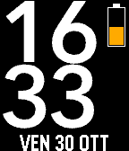

# IgiWatchAlarm



A dynamic and feature-rich smartwatch application for Pebble smartwatches that combines high-contrast typography, customizable orientation, daily health tracking, and an integrated alarm system.

---

## Features

- **Integrated Smart Alarm**:
  - Configure alarm activation and target time directly from the Pebble mobile app settings (Clay).
  - Background scheduling via the **Pebble Wakeup API** (fires even if the app was closed).
  - Rhythmic **"tic" vibration pulse every second** (up to a maximum of 15 seconds).
  - Dedicated alarm screen displaying the current time at the top, a large ringing alarm clock graphic in the center, and a dismissal hint at the bottom.
  - Dismiss immediately with **any physical button** (UP, SELECT, DOWN, BACK) or by tapping/shaking the watch.
  - **15-Second Auto-Stop**: Automatically stops vibrating and returns to the normal watch screen if no button is pressed within 15 seconds.
- **Customizable Orientation**:
  - Display the time in Portrait, Landscape Left, or Landscape Right mode.
  - Quick calibration/glance activated via double-tap.
- **Typography & Localization**:
  - Multiple font options (Avenir Next, Leco 1976, Avenir Next Regular) rendered using `pebble-fctx`.
  - Date localization for Italian, English, French, German, and Spanish.
- **Health & Steps Glance**:
  - Double-tap or shake to display current daily step count and full date format.
- **Status Indicators**:
  - Color-coded battery level meter.
  - Bluetooth disconnection warning and icon.
  - Active alarm indicator.

---

## How to Use

### Normal Clock Mode
- **View Time & Status**: The watchapp shows current time, date, battery level, and connection status. If an alarm is set, an alarm bell icon is displayed next to the battery bar.
- **View Steps & Full Date**: Double-tap the watch face or shake your wrist twice quickly to reveal your daily step count and full date for 5 seconds.
- **Exit App**: Press the **BACK** button when the alarm is not ringing to return to the Pebble launcher.

### Alarm Mode
1. **Set the Alarm**: Open the Pebble mobile app on your smartphone, navigate to the settings of **IgiWatchAlarm**, toggle **Enable Alarm**, and choose your desired time.
2. **When the Alarm Rings**:
   - The watch vibrates with a repeating pattern.
   - The screen shows the current time in large numbers at the top and a large ringing alarm illustration in the center.
3. **Stop the Alarm**:
   - Press **any button** (UP, SELECT, DOWN, or BACK) or tap the watch to stop it immediately.
   - If not dismissed manually, the alarm will automatically silence and return to the normal screen after **15 seconds**.

---

## Supported Platforms

- **Pebble Classic / Steel** (`aplite`)
- **Pebble Time / Time Steel** (`basalt`)
- **Pebble Time Round** (`chalk`)
- **Pebble 2 SE / HR** (`diorite`)
- **Pebble Time 2** (`emery`)

---

## Development & Building

### Prerequisites
- Pebble SDK 4.33.1 or Rebble development tools.

### Commands

```bash
# Build the application for all platforms
pebble build

# Install and run on the basalt emulator
pebble install --emulator basalt

# Take a screenshot from the running emulator
pebble screenshot --no-open screenshot.png
```

For complete technical and architectural details, refer to [HANDOFF.md](file:///home/igino/pebble/igiwatchalarm/HANDOFF.md).
